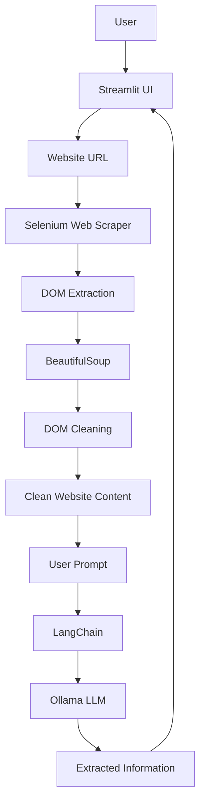
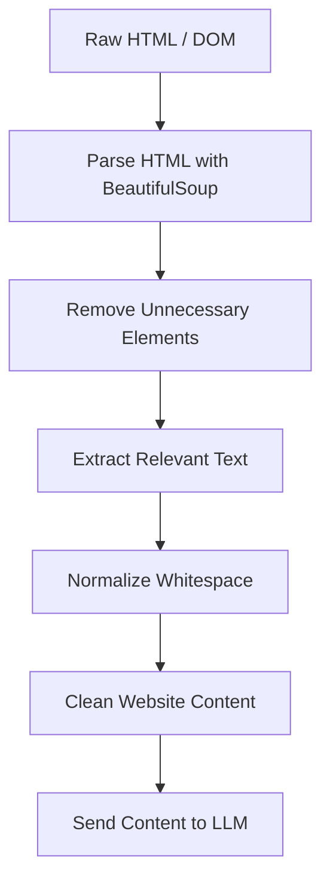

# 🤖 AI Web Scraper

An AI-powered web scraping application built with Python that extracts website content and uses Large Language Models (LLMs) to retrieve specific information through natural language prompts.

The application allows users to enter a website URL, scrape its content, clean the DOM structure, and interact with the extracted data using AI.

This project explores the integration of web scraping, browser automation, HTML processing, and local LLMs to build an intelligent information extraction tool.

---

## 📌 Project Overview

Traditional web scraping often requires manually writing extraction rules for each website. This project combines web scraping techniques with Large Language Models to make information extraction more flexible and accessible.

By leveraging Selenium, BeautifulSoup, LangChain, and Ollama, the application can:

- Scrape website content from a given URL.
- Handle dynamic websites using browser automation.
- Clean and process the extracted DOM content.
- Send website content to an LLM.
- Extract relevant information based on user-defined prompts.
- Display results through an interactive Streamlit interface.

## ✨ Features

- 🌐 **Dynamic Web Scraping:** Extract website content using Selenium.
- 🧹 **DOM Cleaning:** Remove unnecessary HTML elements and simplify website content.
- 🧠 **AI-Powered Parsing:** Use LLMs to extract relevant information from scraped data.
- 💬 **Natural Language Prompts:** Specify what information you want to retrieve.
- 🖥️ **Interactive UI:** Use a Streamlit interface to interact with the scraper.
- 🏠 **Local LLM Integration:** Run AI models locally using Ollama.
- 🔍 **Flexible Extraction:** Adapt extraction requests to different website structures.
- ⚡ **Content Optimization:** Reduce unnecessary HTML and improve LLM input quality.

## 🛠️ Tech Stack

| Technology | Purpose |
|---|---|
| Python | Core application |
| Selenium | Browser automation and dynamic scraping |
| BeautifulSoup | HTML parsing and content extraction |
| LangChain | LLM integration and prompt handling |
| Ollama | Running local language models |
| Streamlit | Interactive web interface |
| ChromeDriver | Chrome browser automation |
| Bright Data | Optional web scraping infrastructure |

## 🏗️ Architecture



---

## 🌐 Web Scraping with Selenium

Selenium is used to automate a web browser and extract website content.

Unlike simple HTTP-based scraping, Selenium can interact with webpages that rely on JavaScript to load their content.

### Why Selenium?

- Supports dynamic websites.
- Allows browser automation.
- Can wait for JavaScript-rendered content.
- Provides access to the rendered DOM.
- Supports interaction with webpage elements.

### Scraping Workflow

1. Initialize the Chrome WebDriver.
2. Navigate to the target URL.
3. Wait for the page to load.
4. Retrieve the rendered HTML.
5. Extract the DOM content.
6. Pass the HTML to BeautifulSoup for processing.

---

## 🛡️ Handling Website Restrictions

Web scraping can sometimes be challenging because websites implement mechanisms to limit automated access.

These mechanisms may include CAPTCHAs, IP-based rate limiting, and bot detection systems.

### Common Challenges

| Challenge | Description |
|---|---|
| CAPTCHAs | Tests designed to distinguish human users from automated browsers. |
| IP Bans | Temporary or permanent restrictions applied to an IP address after excessive or suspicious requests. |
| Rate Limiting | Limits on the number of requests allowed within a specific period. |
| Bot Detection | Systems that identify automated browsing through browser behavior or request patterns. |

### Bright Data Integration

The tutorial introduces Bright Data as a solution for handling certain scraping challenges.

Bright Data provides web scraping infrastructure and proxy services that can help access publicly available web content while managing IP-based restrictions.

Depending on the service used, it may provide:

- Proxy infrastructure for web requests.
- Browser-based scraping solutions.
- Tools for handling dynamic websites.
- Managed scraping capabilities.

### Best Practices

- Respect website Terms of Service.
- Avoid sending excessive requests.
- Use appropriate delays between requests.
- Handle HTTP errors and access restrictions.
- Avoid collecting private or sensitive information.
- Do not attempt to bypass authentication or security controls.

**Note:** Proxy services do not guarantee access to every website. CAPTCHAs and access restrictions should be handled according to the target website's terms and applicable laws.

---

## 🧹 Cleaning DOM Content

Websites contain a large amount of HTML that is not necessarily useful for AI-based information extraction.

The Document Object Model (DOM) represents the structure of a webpage. When scraping a website, the raw DOM may include navigation menus, scripts, styles, advertisements, and other irrelevant elements.

Sending the entire DOM to an LLM can lead to:

- Increased token consumption.
- Higher processing costs.
- Longer response times.
- Reduced relevance of extracted information.

### Why DOM Cleaning Matters

The goal is to transform raw HTML into a clean and compact representation of the website's meaningful content.

### DOM Cleaning Pipeline



### Removing Unnecessary HTML Elements

Elements such as scripts, styles, navigation menus, and footers are often removed because they usually contain information unrelated to the main content.

```python
from bs4 import BeautifulSoup

def clean_dom_content(html_content):
    soup = BeautifulSoup(html_content, "html.parser")

    for element in soup([
        "script",
        "style",
        "nav",
        "footer",
        "header",
        "noscript",
        "svg"
    ]):
        element.decompose()

    text = soup.get_text(separator=" ")

    cleaned_text = " ".join(text.split())

    return cleaned_text
```

### Explanation

1. **Parse the HTML:** BeautifulSoup converts the raw HTML into a structured object that can be manipulated.
2. **Remove irrelevant elements:** Scripts, styles, navigation menus, and other unnecessary elements are removed.
3. **Extract text:** `get_text()` retrieves the remaining textual content.
4. **Normalize whitespace:** `" ".join(text.split())` removes excessive spaces and line breaks.
5. **Prepare the content:** The cleaned text is ready to be processed by an LLM.

### Before and After Cleaning

**Raw HTML:**

```html
<html>
    <head>
        <script>alert("Hello");</script>
        <style>body { color: red; }</style>
    </head>
    <body>
        <nav>Home | About | Contact</nav>
        <h1>AI Web Scraping</h1>
        <p>Extract useful information from websites.</p>
        <footer>Copyright 2026</footer>
    </body>
</html>
```

**Cleaned Content:**

```text
AI Web Scraping Extract useful information from websites.
```

### Benefits

- Reduces irrelevant information.
- Improves the quality of LLM responses.
- Reduces token usage.
- Makes prompt construction easier.
- Helps the application focus on meaningful website content.

**Note:** DOM cleaning is a preprocessing step. It does not guarantee that all extracted content is relevant or accurate.

---

## 🧠 AI-Powered Content Parsing

After scraping and cleaning the website content, the application uses an LLM to extract information based on the user's prompt.

LangChain is used to connect the cleaned content with the language model.

Ollama allows the application to run supported language models locally.

### Parsing Workflow

1. Receive cleaned website content.
2. Create a prompt containing the website content and user request.
3. Send the prompt to the LLM through LangChain.
4. Process the model response.
5. Display the extracted information.

### Example Prompt

```text
Extract the following information from the website:

- Main topic
- Important facts
- Product names
- Contact information

Use only the information available in the provided content.
If a field is missing, indicate that it was not found.
```

### Example

**Input:**

```text
Website content:
AI Web Scraping is a technique used to extract information
from websites using automated tools.
```

**User Prompt:**

```text
What is the main topic of this website?
```

**Expected Output:**

```text
The main topic is AI Web Scraping.
```

---

## 🦙 Ollama Integration

Ollama provides a way to run Large Language Models locally.

This project uses Ollama to process scraped website content without necessarily relying on an external cloud-based LLM API.

### Benefits

- Local model execution.
- Reduced dependency on external AI APIs.
- Greater control over model selection.
- Potentially improved privacy for local processing.

### Model Setup

Download Ollama:

https://ollama.com/

Pull a model:

```bash
ollama pull llama3.1
```

Make sure Ollama is running before launching the application.

The model used by the application should match the model configured in the code.

---

## ⚙️ Installation

### Prerequisites

Make sure you have installed:

- Python 3.10+
- Google Chrome
- ChromeDriver compatible with your Chrome version
- Ollama
- Git

### 1. Clone the Repository

```bash
git clone https://github.com/maryem37/AI-Web-Scraper.git
cd AI-Web-Scraper
```

### 2. Create a Virtual Environment

```bash
python -m venv venv
```

Activate it:

**Windows:**

```powershell
.\venv\Scripts\Activate.ps1
```

**Linux / macOS:**

```bash
source venv/bin/activate
```

### 3. Install Dependencies

```bash
pip install -r requirements.txt
```

### 4. Configure Ollama

```bash
ollama pull llama3.1
```

Verify that the model is available:

```bash
ollama list
```

---

## ▶️ Usage

Start the Streamlit application:

```bash
streamlit run app.py
```

Then:

1. Open the application in your browser.
2. Enter the URL of the website you want to scrape.
3. Extract and clean the website's DOM content.
4. Enter a prompt describing the information you want.
5. Let the AI process the scraped content.
6. View the extracted information in the interface.

---

## 💡 Example Use Cases

### Website Information Extraction

Extract the main title, description, and important links from a website.

### Product Information Extraction

Retrieve product names, descriptions, and other publicly available details.

### Research Assistance

Extract relevant information from publicly accessible research or documentation websites.

### AI-Based Website Analysis

Ask questions about scraped website content using natural language prompts.

---

## 📂 Project Structure

```text
AI-Web-Scraper/
│
├── app.py
├── requirements.txt
├── README.md
├── .gitignore
│
├── scraper/
│   ├── __init__.py
│   ├── scrape.py
│   └── clean.py
│
├── parser/
│   ├── __init__.py
│   └── ai_parser.py
│
├── screenshots/
│   └── demo.png
│
└── utils/
    └── helpers.py
```

*The structure may evolve as the project develops.*

---

## 🔮 Future Improvements

- [ ] Add support for multiple LLM providers.
- [ ] Implement structured output using Pydantic.
- [ ] Add JSON and CSV export functionality.
- [ ] Improve handling of large website content with chunking.
- [ ] Implement a RAG pipeline for querying large scraped websites.
- [ ] Add scraping history and caching.
- [ ] Improve error handling and website compatibility.
- [ ] Add Docker support.
- [ ] Add unit and integration tests.
- [ ] Implement website content summarization.

---

## ⚠️ Disclaimer

This project is intended for educational and research purposes.

Always respect website Terms of Service, `robots.txt`, copyright, and applicable laws.

Avoid scraping private or restricted data. Do not attempt to bypass CAPTCHAs, access controls, or anti-bot protections without explicit authorization.

The application should only be used on websites where scraping is permitted.

---

## 🙏 Acknowledgments

This project is inspired by the AI Web Scraper tutorial by [Tech With Tim](https://www.youtube.com/@TechWithTim).

Original tutorial resources:

- [Original GitHub Repository](https://github.com/techwithtim/AI-Web)
- [Ollama](https://ollama.com/)
- [Selenium Documentation](https://www.selenium.dev/documentation/)
- [LangChain Documentation](https://python.langchain.com/)
- [BeautifulSoup Documentation](https://www.crummy.com/software/BeautifulSoup/bs4/doc/)
- [Streamlit Documentation](https://docs.streamlit.io/)

---

## 👩‍💻 Author

**Mariem Kbaier**

Computer Engineering Student at ENIS | AI & Data Engineering

- GitHub
